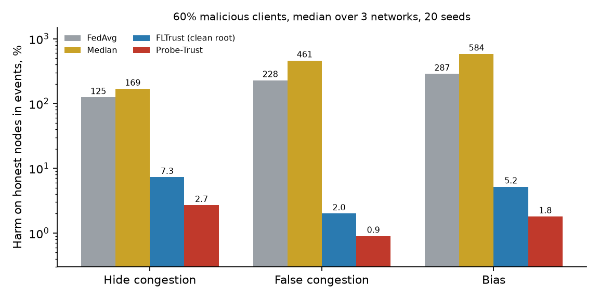

# Probe-Trust: Verifying Untrusted Federated Traffic Forecasters with Rule-Based Probe Windows

**Abzal Gabdullin**

*Code, raw per-run logs and analysis for the manuscript (preprint in preparation; PDF: [`docs/probe_trust_preprint.pdf`](docs/probe_trust_preprint.pdf)).*

## Abstract

Federated learning and multi-agent systems aggregate contributions whose behaviour the aggregator cannot inspect. Existing defences rely on a clean root dataset or on cohort statistics that presuppose an honest majority. For forecasting tasks in which the direction of the output for a controlled input follows from a domain rule, we study **Probe-Trust**: the server sends each submitted model synthetic probe windows (speed must not rise in a congestion probe nor collapse in a free-flow probe), measures the violation of this *absolute* rule, and converts it into a soft aggregation weight. We measure harm on honest nodes during real congestion events on METR-LA, PEMS-BAY and PeMS-D7(M). The score needs neither labels, nor a clean root, nor knowledge of the attacker share, and it remains valid when attackers are the majority.

## Headline result



*Harm on honest nodes in real congestion events (relative RMSE increase against clean FedAvg), 60% malicious clients, median over three networks, 20 seeds. Probe-Trust keeps the harm at 2.7% or less; paired differences to FLTrust with a clean root are small but significant (hide −3.7 pp, 95% bootstrap CI [−5.2; −1.5]).*

| Condition (60% attackers) | FedAvg | Median | FLTrust | Probe-Trust |
|---|---:|---:|---:|---:|
| Hide congestion | +125 % | +169 % | +7.3 % | **+2.7 %** |
| False congestion | +228 % | +461 % | +2.0 % | **+0.9 %** |
| Bias | +287 % | +584 % | +5.2 % | **+1.8 %** |

Scoring the *same probes relative to the cohort* (receiver-domain style) gives no protection at 60% attackers (+124 % on hide), which isolates the contribution of the absolute rule.

## What was tested

| Question | Finding | Where |
|---|---|---|
| Ablation: absolute vs cohort-relative scoring | absolute rule is what matters | `results/abl_*`, paper §VI |
| Adaptive attackers training on probes (exact / own / generic), probe-share sweep | harm bounded by a few percent; stealth trades off against attack strength | `rev3_Q3_*`; harm vs attacker share: `docs/fig_hide_share.png` |
| Root of trust (poisoned / small / biased) | Probe-Trust degrades gracefully, FLTrust does not | `docs/fig_rootweak.png` |
| Further baselines: Min-Max, Fang, scale-up, Zeno++, FLAME-style | root-based methods are as good as probes when a clean root exists; FLAME-style fails without an honest majority | `rev4_*` |
| Strong non-IID data; transformer, MLP and graph-augmented GRU | harm ≤ 2.8 % without retuning | `rev3_N_*`, `rev3_A_*`, `rev5_G_*` |
| Detectability of probes | a classifier separates synthetic probes from real windows (AUC 0.96–1.00); public-history probes are harder to detect (AUC 0.5–0.8) but protect less against bias | `src/probe_detect.py`, `same_*` |
| Second domain: solar power (NREL, 137 plants) | false-drop and bias attacks stopped (≤ 0.9 %); the hide attack is not (+6.7 % / +18.7 %) | `rev6_S_*` |
| Ensembles of LLM agents (8 models) | supported for 6 of 8 models; not for Mistral-7B and Gemma-2-9B (false congestion); Llama-3.1-8B untestable | `agentic/`, `results/analysis/agentic_*` |

## Limitations (stated in the manuscript)

* The guarantee is **empirical and conditional**: shifts inside the dead zone of the rule (about 6 mph) are not prevented, probes must lie in the regime the attacker manipulates, and the rule has to be specified per domain.
* Synthetic probes are **easy to distinguish from real inputs**, so a probe-detecting adversary is not excluded.
* Update flipping and trigger backdoors are not stopped without a root-based check; Probe-Trust alone is only partly effective against the Fang attack.
* Forecasters are small (GRU, transformer encoder, MLP, graph-augmented GRU); full spatio-temporal graph networks were not tested. FedMID-style, FLAME-style and Zeno++ baselines are our re-implementations (no official code found).
* The LLM experiment is a controlled numeric-consensus task and is model-dependent.

## Reproducibility

```bash
git clone https://github.com/asm0ra/probe-trust && cd probe-trust
python -m venv venv && . venv/bin/activate && pip install -r requirements-freeze.txt
# datasets (public, not redistributed): METR-LA, PEMS-BAY, PeMS-D7(M), NREL Solar-Energy (LSTNet) -> data/
bash run_all.sh                       # main grid, ~2-4 h on one GPU
bash run_all.sh --analysis-only       # rebuild tables and figures from results/*.jsonl
```

Each run is one line of `results/*.jsonl` (method, attack, share, seed, honest-node RMSE in events and overall, weights, separation AUC). Review-response experiments: `run_review{,2,3,4,5,6}.sh`, `run_same.sh`; the paper is built from `paper/` (`paper_numbers_rev.json` ← `paper/review_data.py`). Seeds 0–4 (main), 20 seeds for the 60% comparison, probe seeds 777/778. Environment: Python 3.14, torch 2.13 (ROCm 7.1); one simulated run takes about 2.7 s on a consumer GPU. 

## Repository layout

```
src/          simulator (bfl.py), data loaders, drivers, probe-detectability test
analysis/     tables, causal/paired effects, defence-selection agent
agentic/      LLM-agent ensemble experiment (prompts, answers, analysis)
results/      raw per-run logs (jsonl) and analysis outputs
paper/        manuscript sources (IEEE style), figures, number extraction
docs/         figures for this README, preprint PDF
```

## Citation

```bibtex
@misc{gabdullin2026probetrust,
  author = {Gabdullin, Abzal},
  title  = {Probe-Trust: Verifying Untrusted Federated Traffic Forecasters with Rule-Based Probe Windows},
  year   = {2026},
  note   = {Preprint in preparation},
  url    = {https://github.com/asm0ra/probe-trust}
}
```

## License

MIT, see [`LICENSE`](LICENSE). Datasets keep their original licences.
